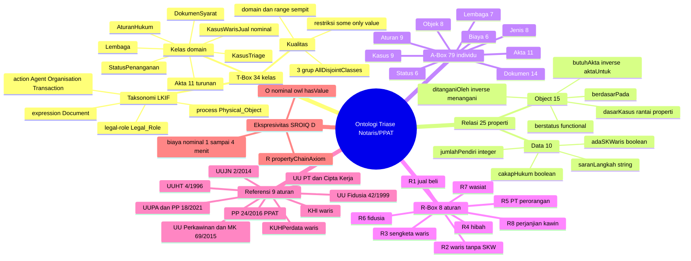
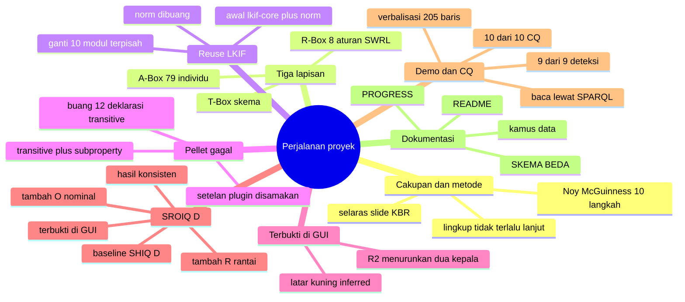

# Peta pikiran notaris-triage

Dua diagram: struktur ontology, lalu perjalanan pekerjaan. Sumbernya sama dengan
spreadsheet `notaris-triage-kamus-data.xlsx`.

## 1. Struktur ontology

## 2. Perjalanan pekerjaan

